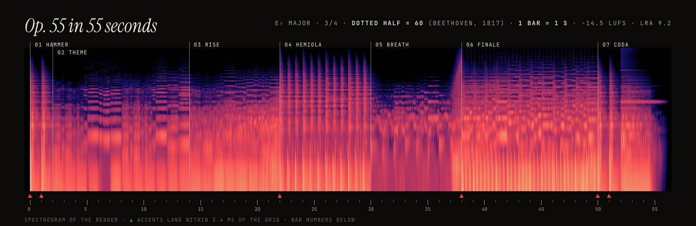

<p align="center"></p>

<p align="center">
<b>영상 배경음악을 Claude가 코드로 작곡하고, 로컬에서 렌더하고, 숫자로 검증한다.</b><br>
Claude 스킬. 음악 생성 API도, 루프도, 스톡 음원도 쓰지 않는다. 같은 악보면 같은 바이트.
</p>

<p align="center">


</p>

<p align="center"><a href="#들어보기">들어보기</a> · <a href="#설치">설치</a> · <a href="#왜-op55인가">왜 op55인가</a> · <a href="#동작-방식">동작 방식</a> · <a href="README.md">English</a></p>

---

## 왜 op55인가

**Opus 5.5 → Op. 55.**

- **Op. 55**는 베토벤 교향곡 3번 E♭장조 「영웅」의 작품번호다.
- 베토벤은 1802년 10월 하일리겐슈타트 유서를 썼다. 귀가 멀어 가고 있음을 털어놓고, 그래도 작곡을 계속하기로 다짐한 편지다.
- 「영웅」은 그 몇 달 뒤인 1803~1804년에 쓴 곡이다. 청력을 잃어 가던 작곡가가 처음 내놓은 대작이다.

Claude는 아예 듣지 못한다. 그래서 op55는 베토벤이 점점 그래야 했던 방식으로 작곡한다. 음 하나하나가 어떻게 울릴지 정확히 알고, 적고, 소리 대신 종이를 확인한다.

> 「영웅」의 표지에는 원래 *Sinfonia grande, intitolata Bonaparte*(보나파르트라는 제목의 대교향곡)라고 적혀 있었다. 1804년 나폴레옹이 스스로 황제가 되자, 베토벤은 그 이름을 너무 세게 긁어 지워 종이에 구멍을 냈다. 배너의 그림이 그 구멍이고, 구멍 너머로 박 격자가 빛난다.

<p align="center"></p>

베토벤의 책상에서 두 가지가 더 코드로 들어왔다. 둘 다 요한 네포무크 멜첼이 만든 물건이다.

- **메트로놈.**
  - 멜첼은 1815년에 메트로놈 특허를 냈다. 베토벤은 메트로놈 표기를 처음 출판한 작곡가 가운데 하나다(1817년).
  - 「영웅」 1악장에 그가 적은 표기는 *점2분음표 = 60*이다. 3/4박자 한 마디가 1초다.
  - op55의 박 격자는 샘플 단위로 정확하다. 「영웅」 데모는 베토벤 자신의 템포로 55마디이고, 그래서 정확히 55초다.
- **보청 나팔.**
  - 멜첼은 베토벤의 보청 나팔도 만들었다. op55의 보청 나팔은 `verify.py`다.
  - 음량과 트루 피크를 재고, 모든 히트의 시작이 격자에 맞는지 재고, 섹션 음량이 계획한 에너지를 따르는지 본다.
  - 파형과 스펙트로그램도 그린다. Claude는 이 그림을 이미지로 읽는다.

## 왜 지금인가

5분짜리 영상 음악을 코드로 쓰려면 편곡 전체를 머릿속에 들고 있어야 한다. 150마디, 섹션 11개, 나레이션이 쉬는 자리, 샘플 단위로 정확한 박 격자까지다. 그 상태로 450줄 남짓을 한 번에 쓰고, 자기 결과의 숫자와 스펙트로그램을 읽고, 보이는 문제를 고쳐야 한다.

**Claude Opus 5.5**에 와서 이 고리가 처음부터 끝까지 닫혔다. 이 레포의 「영웅」 큐는 Opus 5.5가 한 세션 안에서 빈 파일부터 계획하고, 쓰고, 렌더하고, 검증한 것이다. 아래 수치가 그 결과다. 엔진의 샘플 악기 층과 이 레포도 Opus 5.5가 같은 세션에서 만들었다.

돈도 들지 않는다. 나레이션이 있는 5분 설명 영상에서 음악 API로 후보 네 곡을 만들어 한 곡을 쓰는 데 약 $7가 들었다. op55는 0원이고, 같은 길이를 35초에 렌더하고, 악보가 남는다.

## 들어보기

<p align="center"></p>

| | |
| --- | --- |
| ▶ **[Op. 55 in 55 seconds](https://cdn.jsdelivr.net/gh/ynginkim/op55@main/assets/demo/eroica-55s.mp3)** | **샘플 오케스트라:** 현, 호른, 금관, 팀파니, 플루트, 업라이트 피아노. 그 밑에 합성 서브, 킥, 라이저.<br>**구성:** 망치로 내리치는 화음 두 번, C♯로 미끄러지는 E♭ 첼로 테마, 마디선과 싸우는 헤미올라, 호른 피날레.<br>**측정값:** −14.5 LUFS · 리미터 ≤ 3.7dB · 악센트 6/6이 격자 3.4ms 안 · 에너지 순위 상관 +0.96 |
| ▶ **[pstack-harness 피날레](https://cdn.jsdelivr.net/gh/ynginkim/op55@main/assets/demo/pstack-finale-synth.mp3)** | **전부 합성음:** 나레이션이 있는 300초 설명 영상의 마지막 38초. 모토릭 펄스, 프린터 스테퍼 틱, LOCK 화음까지 다섯 계단으로 오르는 빌드업.<br>영상 프레임을 하나도 바꾸지 않고 생성 음악을 대체했다 |

<p align="center"><br>
<sub>헤드폰을 권한다. Claude는 두 곡 모두 들어 본 적이 없다.</sub></p>

## 설치

```bash
npx skills add ynginkim/op55        # Claude Code를 고른다(또는 -a claude-code, 모든 프로젝트에 쓰려면 -g)
```

그리고 이렇게 부탁한다.

> 이 제품 영상에 60초짜리 배경음악 만들어줘. 따뜻하게, 피아노랑 현악기로. 0:12와 0:48에 히트, 나레이션은 0:05~0:40.

처음 쓸 때 Claude가 `scripts/setup.mjs`를 돌려 사운드폰트 뱅크(88MB)를 `~/.cache/op55`에 받는다. 필요한 것은 Node 18 이상, Python 3과 numpy, ffmpeg다.

## 동작 방식

```
 브리프 ──▶ 큐 시트 ──▶ 격자 ──▶ score.mjs ──▶ 렌더 ─────────▶ 검증 ─────────────▶ music.wav
           섹션        마디가   Claude가      합성 악기       LUFS, 트루 피크       analysis.json
           에너지      곧       쓴다          + 사운드폰트    격자 대비 어택        music.meta.json
           악센트      싱크                   샘플            계획 대비 에너지      (크레딧)
           빈틈        지점                   + 마스터링      스펙트로그램
```

- **악보가 곧 코드다.** 큐 하나는 ES 모듈 하나다. 격자, 섹션과 악센트, 음표 이벤트를 돌려주는 `compose()`로 이루어진다. 모든 음은 초가 아니라 `bar(k, beat)`로 놓는다.
- **두 오케스트라, 하나의 믹서.**
  - **합성 악기**는 무게와 정밀함을 맡는다: `pad bass kick tick pluck arp glass bell piano fx`.
  - **샘플 악기**는 실감을 맡는다. General MIDI/GS의 모든 악기와 드럼 키트, 실제 피아노 두 대를 쓸 수 있다.
  - 샘플 악기는 레포에 넣어 둔 [spessasynth_core](https://github.com/spessasus/spessasynth_core)가 오프라인으로 연주한다. 모든 이벤트가 정확한 샘플 위치에 놓인다.
  - 둘 다 같은 센드(플레이트, 홀, 템포 동기 딜레이), 음량 모양, 버스 글루, 트루 피크 리미터를 지난다.
- **격자가 계약이다.** `analysis.json`은 비트 트래커의 출력과 같은 모양이다. 하지만 악보에서 계산해 쓰므로 오차가 없다. 화면의 컷과 히트가 밀림 없이 다운비트에 놓인다.
- **결정적이다.**
  - 모든 무작위 선택은 이름 붙은 시드 스트림에서 나온다.
  - 같은 악보, 시드, 뱅크면 WAV가 바이트까지 같다.
  - 승인된 해시는 `tools/regress.sh`가 지킨다.
- **검증하고, 그다음 듣는다.** `verify.py`가 숫자와 그림을 내고, Claude가 그것을 보고 고친다. 사람은 마지막에 듣는다.

### 악기 뱅크

| 뱅크 | 무엇 | 라이선스 | 크기 |
| --- | --- | --- | --- |
| `gm` | [GeneralUser GS 2.0.3](https://github.com/mrbumpy409/GeneralUser-GS): GM/GS 전체, 드럼 키트 13종 | 개인·상업 음악에 자유롭게 사용 | 32MB |
| `upright` | [Upright Piano KW](https://freepats.zenvoid.org/Piano/acoustic-grand-piano.html)(FreePats): 거실에서 녹음한 가와이 업라이트 | CC0 | 56MB |
| `grand` | [Salamander Grand Piano V3](https://freepats.zenvoid.org/Piano/acoustic-grand-piano.html): 야마하 C5, 벨로시티 16단(선택) | CC BY 3.0, 크레딧 필요 | 1.2GB |

op55는 라이선스를 확인하지 않은 소리를 쓰지 않는다. 크레딧이 필요한 큐면 `music.meta.json`에 그 문구가 적힌다.

### 악보 한 토막

```js
export const grid = { bpm: 180, t0: 0.5, beatsPerBar: 3 };          // 점2분음표 = 60: 한 마디가 1초
export const sections = [{ bar: 0, name: 'Hammer', energy: 0.9 }, { bar: 2, name: 'Theme', energy: 0.4 } /* … */];
export const ensemble = {
  celli: { bank: 'gm', preset: 'Cello', pan: 0.3 },
  horns: { bank: 'gm', preset: 'French Horns', sends: { hall: 0.42 } },
};
export function compose({ bar, BEAT, ccRamp }) {
  const celli = [[0, 2, 51], [2, 1, 55]].map(([b, len, midi]) => ({ t: bar(2, b), dur: len * BEAT, midi, vel: 0.62 }));
  const horns = ccRamp('expression', bar(14), bar(22), 0.5, 1);    // 계단이 아니라 부풀림
  return { events: { celli, horns, kick: [{ t: bar(0), vel: 0.35 }] } };
}
```

전체 예시: [`eroica.score.mjs`](skills/op55/scripts/examples/eroica.score.mjs). API: [`references/score.md`](skills/op55/references/score.md).

### 검증

```
[loudness] integrated -14.5 LUFS (target -14.5) ✓ · true peak -1.3 dBTP ✓ · LRA 9.2 LU · clipped samples 0
[grid] analysis.json: 180 BPM, 171 beats (max |beat - grid| 0.33 ms), 57 downbeats (max 0.00 ms) ✓
[onsets] kick: 52 hits, offset vs grid median +0.87 ms, max |1.17| ms ✓
[onsets] accent Hammer 1        bar  0.00  onset +2.60 ms ✓
[onsets] accent Finale          bar 38.00  onset +0.54 ms ✓
  rank correlation energy vs loudness: +0.96 ✓
```

## showreel과 함께

- op55는 [showreel](https://github.com/revfactory/showreel)의 음악 단계에서 출발했다. showreel은 한국어 모션그래픽 영상을 처음부터 끝까지 만드는 Claude 스킬이다.
- showreel은 op55가 쓰는 두 파일을 이미 읽는다: `music.file`과 `timeline.py --music-analysis`.
- 자세한 연결 방법은 [`references/showreel.md`](skills/op55/references/showreel.md)에 있다.

## 레포 구성

```
skills/op55/
  SKILL.md                    스킬 본문: 절차, 팔레트, 규칙
  references/                 악보 API, 영상용 편곡, 검증, showreel 연결
  scripts/
    render.mjs  verify.py     악보 렌더, 측정
    setup.mjs   banks.mjs     뱅크 받기(SHA-256 확인), 프리셋 찾기
    lib/                      dsp, 격자, 합성 악기, 샘플러, 엔진, 분석
    examples/                 starter(합성), eroica(샘플 + 합성), pstack-harness(300초, 합성)
    vendor/                   spessasynth_core 4.3.22 번들(Apache-2.0)
tools/                        regress.sh(승인 해시), art/(README 그림: 프롬프트, 합성기, 데모 영상)
```

## 로드맵

- **악기 확장:** CC0 오케스트라 라이브러리(VSCO 2 CE, VCSL)를 위한 SFZ 플레이어. General MIDI보다 다양한 주법을 쓴다.
- **학습된 귀:**
  - Audiobox Aesthetics 점수로 여러 테이크의 순위를 매긴다.
  - 장르별 기준 프로필로 "시네마틱"이나 "로파이"에도 숫자를 붙인다.
- **렌더 전 검사:** 프레이즈 길이나 화성 리듬을 코퍼스 백분위와 비교하는 악보 단계 구조 검사.
- **넘겨주기:** DAW로 가져갈 MIDI와 스템 내보내기.

## 크레딧

- **엔진:** [showreel 포크](https://github.com/ynginkim/showreel)에서 처음 만들어 이곳으로 옮겼다. 코드는 MIT다.
- **샘플러:** spessasus의 [spessasynth_core](https://github.com/spessasus/spessasynth_core)(Apache-2.0). 라이선스와 함께 `scripts/vendor/`에 넣었다.
- **뱅크:**
  - GeneralUser GS: S. Christian Collins
  - Upright Piano KW: FreePats(CC0)
  - Salamander Grand Piano: Alexander Holm(CC BY 3.0)
- **그림:**
  - Codex imagegen으로 생성했다. 프롬프트는 `tools/art/prompts`에 있다.
  - 글자는 코드로 합성했다(`tools/art/compose.mjs`).
- **음악:** 루트비히 판 베토벤, 교향곡 3번 E♭장조 Op. 55(1804), 퍼블릭 도메인. 결국 "한 위대한 인물의 추억을 기리며" 헌정되었다.
