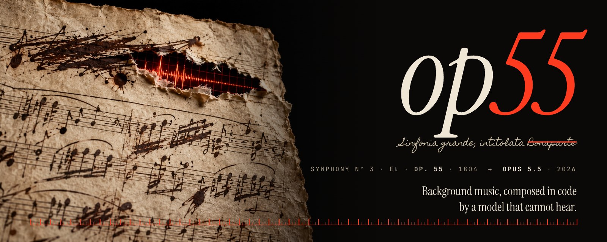
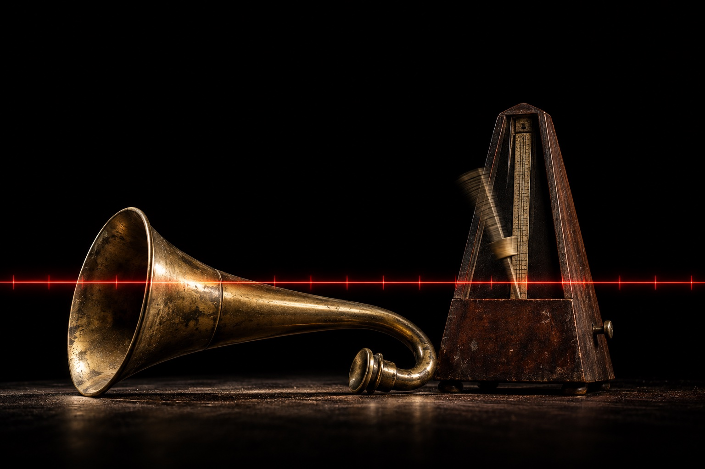

<p align="center"></p>

<p align="center">
<b>Background music for video, composed in code by Claude, rendered offline, verified by numbers.</b><br>
A Claude skillset. No music APIs, no loops, no stock tracks. Same score, same bytes.
</p>

<p align="center">


</p>

<p align="center"><a href="#listen">Listen</a> · <a href="#install">Install</a> · <a href="#why-op55">Why op55</a> · <a href="#how-it-works">How it works</a> · <a href="README.ko.md">한국어</a></p>

---

## Why "op55"

**Opus 5.5 → Op. 55.**

Op. 55 is Beethoven's Symphony No. 3 in E-flat, the *Eroica*. He wrote it in 1803 and 1804, months after the Heiligenstadt Testament, the letter of October 1802 in which he admitted he was going deaf and resolved to keep composing anyway. It is the first great work of a composer who was losing his hearing.

Claude cannot hear at all. So op55 composes the way Beethoven increasingly had to: know exactly what every note will do, write it down, and check the page instead of the sound.

> The title page once read *Sinfonia grande, intitolata Bonaparte*. When Napoleon crowned himself emperor in 1804, Beethoven scratched the name out so hard that he tore a hole through the paper. The banner is that hole, with a beat grid shining through.

<p align="center"></p>

Two more things from Beethoven's desk made it into the code. Both were built by the same man, Johann Nepomuk Mälzel.

- **The metronome.** Mälzel patented it in 1815, and Beethoven was among the first composers to publish metronome marks (1817). For the *Eroica*'s first movement he wrote *dotted half = 60*: one bar of 3/4 per second. op55's grid is exact to the sample. Its *Eroica* demo is 55 bars at Beethoven's own tempo, so it lasts 55 seconds.
- **The ear trumpet.** Mälzel also built Beethoven's ear trumpets. op55's ear trumpet is `verify.py`. It checks loudness and true peak, times every hit against the grid, compares each section's loudness with the planned energy, and draws waveforms and spectrograms that Claude reads as images.

## Why now

To write a five-minute score as code, you have to hold the whole arrangement in your head: 150 bars, eleven sections, the narrator's pauses, and a grid accurate to the sample. Then you write about 450 lines in one sitting, read your own numbers and spectrograms, and fix what they show.

With **Claude Opus 5.5** that loop closes end to end. Opus 5.5 planned, wrote, rendered and verified the *Eroica* cue in this repo in one session, starting from an empty file and ending with the numbers below. It also wrote the engine's sampled-instrument layer and this repo around it.

It is also free. On a narrated five-minute explainer, generating four candidate tracks with a music API cost about $7 to keep one. op55 costs nothing, renders that cue in 35 seconds, and gives you the source.

## Listen

https://github.com/user-attachments/assets/9f1348a2-a305-417e-9d26-2ca237933841

https://github.com/user-attachments/assets/09cd4678-fe6a-4c5c-b131-3ec5dcf73012

https://github.com/user-attachments/assets/cb2ac109-c193-44be-9398-9627b86ca8a6

| | |
| --- | --- |
| ▶ **[Op. 55 in 55 seconds](https://cdn.jsdelivr.net/gh/ynginkim/op55@main/assets/demo/eroica-55s.mp3)** | **Sampled orchestra:** strings, horns, brass, timpani, flute and upright piano, over a synth sub, kick and riser.<br>**Form:** two hammer chords, then the E♭ cello theme that slips to C♯, a hemiola that fights the bar line, and a horn finale.<br>**Measured:** −14.5 LUFS · limiter ≤ 3.7 dB · 6/6 accents within 3.4 ms of the grid · energy rank correlation +0.96 |
| ▶ **[Product teaser, 40 s](https://cdn.jsdelivr.net/gh/ynginkim/op55@main/assets/demo/product-teaser-40s.mp3)** | **Asked for:** a 40-second product-teaser bed: warm, piano and strings, a hit at 0:20, a gentle end, no narration.<br>**Sampled + synth:** upright piano and GM strings (slow strings, cello, fast strings), with a synth kick, boom and bell on the logo hit.<br>**Form:** Intro, Rise, Hush, Logo, Settle, Close · D major, 4/4, 98 BPM · the hit lands on 20.000 s.<br>**Measured:** −13.0 LUFS · limiter ≤ 3.5 dB · logo hit +1.0 ms from the grid · energy rank correlation +1.00 |
| ▶ **[Lo-fi study beat, 30 s](https://cdn.jsdelivr.net/gh/ynginkim/op55@main/assets/demo/lofi-study-30s.mp3)** | **Asked for:** a 30-second lo-fi study beat for a vlog intro (in Korean).<br>**Sampled + synth:** upright piano, Tine electric piano and a Room drum kit, over a synth bass and kick.<br>**Form:** Intro, Groove, Breath, Full, Outro · C major, 4/4, 84 BPM, swung.<br>**Measured:** −13.0 LUFS · limiter ≤ 3.3 dB · 13 synth kicks and 2 accents within 3 ms of the grid · energy rank correlation +0.90 |

<p align="center"><br>
<sub>Headphones recommended. Claude has not heard any of them.</sub></p>

Ask for it and op55 turns any cue into a video like these (`preview.py`): the spectrogram turns from grey to colour as it plays, with the current section and a timecode. It is optional; the music itself is the deliverable.

## Install

The pinned [`skills@1.7.4` installer](https://github.com/vercel-labs/skills/blob/v1.7.4/package.json) requires **Node ≥ 22.20.0**. The op55 renderer itself requires Node ≥ 18; use Node ≥ 22.20.0 for the complete install-and-render workflow.

```bash
npx skills@1.7.4 add ynginkim/op55        # choose Claude Code (or: -a claude-code; -g for every project)
```

This installs eight skills as one set: the entry point [`op55-mode`](skills/op55-mode/SKILL.md), four work skills and three principles. Keep them together: they read each other through sibling folders, and the render scripts live in one of them (`resolve-op55-tools`).

Then ask:

> Make a 60-second background track for this product video. Warm, piano and strings, hits at 0:12 and 0:48, narration from 0:05 to 0:40.

A request like this starts `op55-mode` by itself. To call it by name, type `/op55-mode` in Claude Code or `$op55-mode` in Codex. The other seven skills are called by the mode (or by another skillset such as showreel), not on their own.

On first use Claude runs `setup.mjs` from `resolve-op55-tools`, which downloads the SoundFont banks (88 MB) into `~/.cache/op55/banks`. Requirements: Node ≥ 18, Python 3 with numpy, and ffmpeg (plus Pillow for the optional preview video).

**Upgrading from the single `op55` skill.** The entry used to be `/op55`; it is now `/op55-mode`. Run the `add` command again to get the new set, then remove the old copy so it cannot shadow the new one: `npx skills@1.7.4 remove op55` in the project, or `npx skills@1.7.4 remove -g op55` if you installed it globally. Your scores and the bank cache are not touched.

## How it works

```
 brief ──▶ cue sheet ──▶ grid ──▶ score.mjs ──▶ render ──────▶ verify ──────────▶ music.wav
           sections      bars     Claude        synth voices    LUFS, true peak     analysis.json
           energy        are      writes it     + SoundFont     onsets vs grid      music.meta.json
           accents       sync                   samples         energy vs plan      (credits)
           gaps          points                 + mastering     spectrograms
```

- **Score as code.** A cue is one ES module: a grid, sections and accents, and a `compose()` that returns note events. Claude places everything with `bar(k, beat)`, never with raw seconds.
- **Two orchestras, one mixer.**
  - **Synth voices** for weight and precision: `pad bass kick tick pluck arp glass bell piano fx`.
  - **Sampled parts** for realism: any General MIDI/GS preset or drum kit, plus two real pianos. They are played by a vendored [spessasynth_core](https://github.com/spessasus/spessasynth_core), offline, with every event on its exact sample.
  - Both feed the same sends (plate, hall, tempo-synced delay), loudness shaping, bus glue and true-peak limiter.
- **The grid is the contract.** `analysis.json` has the same shape as a beat tracker's output, but it is written from the score, so it is exact. Picture cuts and hits sit on downbeats with no drift.
- **Deterministic.**
  - Every random choice comes from a named, seeded stream.
  - The same score, seed and banks give the same WAV byte for byte.
  - `tools/regress.sha256` holds the approved hashes.
- **Verified, then heard.** `verify.py` writes the numbers and pictures, Claude fixes what they show, and a human listens last.

### The orchestra

A **soundbank** supplies the instrument sounds, not the composition. The score says which note to play, when, and how hard; a SoundFont (`.sf2`) bank contains recorded samples and rules mapping pitch and velocity to those sounds. It is neither a finished track nor an AI model. The same score can sound different with another bank. op55 also has synthesized voices: the synth `piano` is separate from the sampled `upright` and `grand` pianos below.

| Bank | What | License | Size |
| --- | --- | --- | --- |
| `gm` | [GeneralUser GS 2.0.3](https://github.com/mrbumpy409/GeneralUser-GS): the full GM/GS set, 13 drum kits | Free for private and commercial music | 32 MB |
| `upright` | [Upright Piano KW](https://freepats.zenvoid.org/Piano/acoustic-grand-piano.html) (FreePats): a Kawai upright in a living room | CC0 | 56 MB |
| `grand` | [Salamander Grand Piano V3](https://freepats.zenvoid.org/Piano/acoustic-grand-piano.html): Yamaha C5, 16 velocity layers (optional) | CC BY 3.0, credit required | 1.2 GB |

The default setup downloads `gm` and `upright`; `grand` is optional. The banks keep their own licenses, separate from op55's MIT code. See [THIRD_PARTY.md](THIRD_PARTY.md) for the terms and the GeneralUser sample-provenance limitation; checking a license is not independent clearance of every original sample. When a cue needs a credit line, `music.meta.json` records it. This does not automatically publish the credit in your video or upload description; include the required attribution where you distribute the result.

#### `banks-v1` versus `v0.1.0`

- [`v0.1.0`](https://github.com/ynginkim/op55/releases/tag/v0.1.0) versions the op55 code and skill.
- [`banks-v1`](https://github.com/ynginkim/op55/releases/tag/banks-v1) is a separate **sound-data distribution**, not op55 version 1.0. Its release assets host gzip-compressed `gm` and `upright` SF2 files plus their source/license notices, keeping large sound files out of the Git source tree.

Setup uses `banks-v1` as its primary download location, extracts the files into `~/.cache/op55/banks`, and checks their SHA-256 hashes. `grand` is downloaded separately from FreePats, not from `banks-v1`. The release's automatic “Source code” ZIP/TAR files are GitHub's source snapshots, not the soundbank downloads. See [RELEASING.md](RELEASING.md) for the separate code and bank-release process.

### A score, abridged

```js
export const grid = { bpm: 180, t0: 0.5, beatsPerBar: 3 };          // dotted half = 60: one bar per second
export const sections = [{ bar: 0, name: 'Hammer', energy: 0.9 }, { bar: 2, name: 'Theme', energy: 0.4 } /* … */];
export const ensemble = {
  celli: { bank: 'gm', preset: 'Cello', pan: 0.3 },
  horns: { bank: 'gm', preset: 'French Horns', sends: { hall: 0.42 } },
};
export function compose({ bar, BEAT, ccRamp }) {
  const celli = [[0, 2, 51], [2, 1, 55]].map(([b, len, midi]) => ({ t: bar(2, b), dur: len * BEAT, midi, vel: 0.62 }));
  const horns = ccRamp('expression', bar(14), bar(22), 0.5, 1);    // a swell, not a step
  return { events: { celli, horns, kick: [{ t: bar(0), vel: 0.35 }] } };
}
```

Full example: [`eroica.score.mjs`](skills/resolve-op55-tools/scripts/examples/eroica.score.mjs). API: [`references/score.md`](skills/op55-compose/references/score.md).

### Verify

```
[loudness] integrated -14.5 LUFS (target -14.5) ✓ · true peak -1.3 dBTP ✓ · LRA 9.2 LU · clipped samples 0
[grid] analysis.json: 180 BPM, 171 beats (max |beat - grid| 0.33 ms), 57 downbeats (max 0.00 ms) ✓
[onsets] kick: 52 hits, offset vs grid median +0.87 ms, max |1.17| ms ✓
[onsets] accent Hammer 1        bar  0.00  onset +2.60 ms ✓
[onsets] accent Finale          bar 38.00  onset +0.54 ms ✓
  rank correlation energy vs loudness: +0.96 ✓
```

## With showreel

op55 started life as the music step of [showreel](https://github.com/revfactory/showreel), a Claude skill that makes Korean motion-graphics videos end to end. The files op55 writes and their shapes are in [`output-contract.md`](skills/resolve-op55-tools/references/output-contract.md). How showreel calls op55 and uses those files is documented in showreel, in [`references/op55.md`](https://github.com/ynginkim/showreel/blob/main/references/op55.md) of the [ynginkim/showreel](https://github.com/ynginkim/showreel) fork.

## Repo

```
skills/
  op55-mode/                  the entry: picks a playbook and runs it to delivery
    playbooks/                create-cue (new BGM), revise-cue (feedback, narration gaps, new music for a finished video)
  op55-compose/               cue sheet, grid, score.mjs; references/ score API, arranging for picture
  op55-render/                render the WAV, analysis and meta; on request a preview video (references/preview.md)
  op55-verify/                read verify.py's numbers and pictures (references/verify.md)
  resolve-op55-tools/         paths, tools, banks, exact commands, licenses; references/output-contract.md
    scripts/
      render.mjs  verify.py   render a score, measure it
      preview.py              on request: a spectrogram video that plays with the cue
      setup.mjs   banks.mjs   fetch banks (SHA-256 checked), browse presets
      lib/                    dsp, grid, synth voices, sampler, engine, analysis
      examples/               starter (synth), eroica (sampled + synth), pstack-harness (300 s, synth)
      vendor/                 spessasynth_core 4.3.22, bundled (Apache-2.0)
    assets/fonts/             Instrument Serif, JetBrains Mono (OFL) for previews
  principle-*/                protect the voice, freeze the grid, arrange for the picture
tools/                        regress.sh (checks), regress.sha256 (approved hashes), art/ (README art: prompts, compositor, demo video)
scripts/                      skillset structure checks (check.py, selftest.py, install_smoke.py); not installed
DESIGN.md                     why the skills are split this way, and the verification record
```

The skillset follows the [meta-harness](https://github.com/ynginkim/meta-harness) layout: a mode that runs playbooks, skills that do the work, principles for judgment calls. Generated by `python3 scripts/check.py . --write-docs`:

<!-- skillset:summary:start -->
mode 1개, playbook 2개, skill 4개, principle 3개 (설치 단위 8개).

검사: `python3 scripts/check.py .`
<!-- skillset:summary:end -->

## Roadmap

- **More instruments:** an SFZ player for CC0 orchestral libraries (VSCO 2 CE, VCSL), for articulations beyond General MIDI.
- **A learned ear:**
  - Audiobox Aesthetics scores to rank alternate takes.
  - Genre reference profiles, so "cinematic" and "lo-fi" have numbers too.
- **Checks before rendering:** score-level structure checks, such as corpus percentiles for phrase length and harmonic rhythm.
- **Handoff:** MIDI and stem export for a DAW.

## Credits

- **Engine:** written for the [showreel fork](https://github.com/ynginkim/showreel) and moved here. The code is MIT.
- **Sampler:** [spessasynth_core](https://github.com/spessasus/spessasynth_core) by spessasus, Apache-2.0. It is vendored, with its license, in `skills/resolve-op55-tools/scripts/vendor/`.
- **Banks:**
  - GeneralUser GS by S. Christian Collins
  - Upright Piano KW by FreePats (CC0)
  - Salamander Grand Piano by Alexander Holm (CC BY 3.0)
- **Art:**
  - Generated with Codex's imagegen. The prompts are in `tools/art/prompts`.
  - Typography is composited in code (`tools/art/compose.mjs`).
- **Music:** Ludwig van Beethoven, Symphony No. 3 in E-flat, Op. 55 (1804), public domain. Dedicated, eventually, to the memory of a great man.

## License scope

MIT covers original code, not third-party banks, fonts, or vendor code. Read [THIRD_PARTY.md](THIRD_PARTY.md) and the original notices in [licenses/banks](licenses/banks) before redistribution.

## 기여와 버전

[기여 안내](CONTRIBUTING.md) · [행동강령](CODE_OF_CONDUCT.md) · [보안 제보](SECURITY.md) · [도움받기](SUPPORT.md) · [변경 기록](CHANGELOG.md) · [버전·릴리스](RELEASING.md)

소스 버전은 [VERSION](VERSION)에서, 발행된 태그·릴리스는 [GitHub Releases](https://github.com/ynginkim/op55/releases)에서 확인한다. 재현 가능한 설치에는 실제 존재하는 태그 또는 전체 40자리 커밋 SHA를 `#REF`로 지정한다. `@name`은 버전이 아니라 skill 선택이다. 비공개 저장소에는 기존 읽기 권한이 필요하다. 설치·구조 검사는 실제 모델 실행이나 산출물 품질 검증과 별개다.

[하네스 패밀리](https://github.com/ynginkim/harness-family) 공통 철학과 목록. 비공개 저장소는 접근 권한이 있는 계정에서만 열린다.
